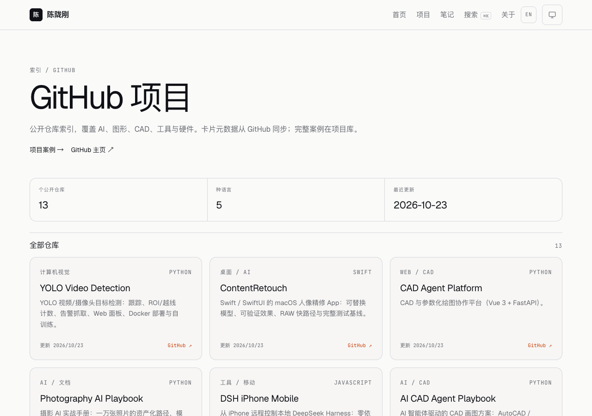
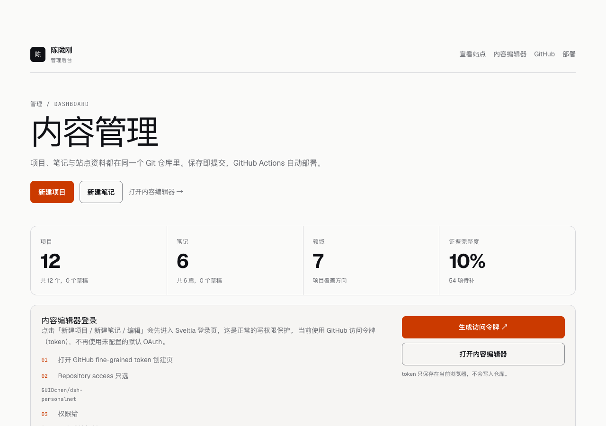

# dsh-personalnet

> 个人网站：7 个领域、12 个项目案例、6 篇技术笔记与 13 个 GitHub 仓库索引。静态优先、零运行时后端、MIT 开源，支持中英文界面。

**在线预览**：<https://guidchen.github.io/dsh-personalnet/> · **Cloudflare 副本**：<https://guidchen.pages.dev/> · **Release**：[v2.8.0](https://github.com/GUIDchen/dsh-personalnet/releases/tag/v2.8.0)

[](#文档)
[](./LICENSE)

## 预览

| 首页                            | 项目库                                |
| ------------------------------- | ------------------------------------- |
|  |  |

| 项目详情                              | 搜索                              |
| ------------------------------------- | --------------------------------- |
|  |  |

| 笔记列表                             | 笔记详情                                   |
| ------------------------------------ | ------------------------------------------ |
|  |  |

| 现在                           | 常用工具                            |
| ------------------------------ | ----------------------------------- |
|  |  |

| English home                               | English projects                                   |
| ------------------------------------------ | -------------------------------------------------- |
|  |  |

| GitHub projects                              | 管理后台                             |
| -------------------------------------------- | ------------------------------------ |
|  |  |

## 管理后台

- 仪表盘：`/admin/`（内容统计、快捷入口、发布流程、待补源码）；只读、noindex。
- 编辑器：`/admin/cms/`（Sveltia CMS，项目/笔记 Markdown + 站点资料 JSON）。
- 本地编辑：`pnpm dev` 后用 Chrome 打开 `/admin/cms/index.html`，选择仓库目录直接写文件。
- 线上编辑：`/admin/cms/` 使用 GitHub fine-grained token（`Contents: Read and write`）；默认 OAuth 未配置，因此登录页只保留 token 入口。
- 图片：项目封面/图库在编辑器中上传到 `public/media/projects/`；单文件 ≤300KB。
- GitHub 项目：`/github/`；后台编辑仓库源，保存后 Actions 同步元数据并部署。详见 [GitHub 项目文档](./docs/28-github-projects.md)。
- Git：每次改动提交并记录；见 [Git 工作流](./docs/30-git-workflow.md)。
- 部署调研：GitHub Pages / Cloudflare Pages / VPS / 自建的成本与边界，见 [部署方案调研](./docs/31-deployment-options.md)。
- Cloudflare Pages：独立构建目标与 workflow 已就绪，见 [Cloudflare 双站部署](./docs/33-cloudflare-pages.md)（待授权/部署）。
- 安全：`noindex`、`robots.txt` 禁止、固定版本 + SRI；详见 [管理后台文档](./docs/22-admin.md)。

## 状态

| 里程碑 | 内容                                    | 状态        |
| ------ | --------------------------------------- | ----------- |
| M0     | 调研、对比、架构、12 篇 ADR、文档基线   | ✅ 完成     |
| M1     | Astro 7 工程脚手架 + CI                 | ✅ 完成     |
| M2     | 设计系统与页面骨架                      | ✅ 完成     |
| M3     | 内容模型与全部页面                      | ✅ 完成     |
| M4     | 搜索、动效、OG、图片优化                | ✅ 完成     |
| M5     | 质量门禁（单测/E2E/a11y/性能）          | ✅ 完成     |
| M6     | MIT 开源发布 v1.0.0                     | ✅ 完成     |
| M7     | 维护基线（手册/简历页/robots/脚手架）   | ✅ 完成     |
| M8     | 技术笔记、合并 RSS、SEO 审计、LQIP      | ✅ 完成     |
| M9     | 审阅借鉴、Hero、Now/Uses、命令面板      | ✅ 完成     |
| M10    | 中英文界面、/en 路由、hreflang          | ✅ 完成     |
| M11    | Sveltia 管理后台、内容模型、校验        | ✅ 完成     |
| M12    | 健康报告、每周审计、Agent 长跑契约      | ✅ 完成     |
| M13    | 公网部署与 v2.0.0 发布                  | ✅ 完成     |
| M14    | 管理仪表盘、站点资料 CMS、JSON 迁移     | ✅ 完成     |
| M15    | 项目封面卡、GitHub 链接、视觉升级       | ✅ 完成     |
| M16    | 媒体上传、图库、内容健康度              | ✅ 完成     |
| M17    | 3 篇笔记、JSON Feed、后台部署状态       | ✅ 完成     |
| M18    | v2.2.0 发布                             | ✅ 完成     |
| M19    | 12 项目/6 笔记英文标题与摘要            | ✅ 完成     |
| M20    | 后台 token-only 登录与登录指引          | ✅ 完成     |
| M21    | GitHub 项目索引、后台源与 Actions 同步  | ✅ 完成     |
| M22    | v2.4.0 发布                             | ✅ 完成     |
| M23    | About/笔记/项目详情、安全模型、CSS 背景 | ✅ 完成     |
| M24    | v2.5.0 发布                             | ✅ 完成     |
| M25    | 滚动流畅度、项目技术细节、笔记实现索引  | ✅ 完成     |
| M26    | v2.6.0 发布                             | ✅ 完成     |
| M27    | 完成度复审、关闭全视口预取、隐私检查    | ✅ 完成     |
| M28    | v2.7.0 发布                             | ✅ 完成     |
| M29    | CSP/安全头、并发探测、公开/私有信息审计 | ✅ 完成     |
| M30    | v2.8.0 发布                             | ✅ 完成     |
| M31    | Cloudflare Pages 配置与双站文档         | ✅ 完成     |
| M32    | Cloudflare Pages 直接上传部署           | ✅ 完成     |
| M33    | Cloudflare 自动部署（API Token）        | ✅ 完成     |

## 技术栈

| 层   | 选择                                               |
| ---- | -------------------------------------------------- |
| 框架 | Astro 7（静态输出、islands）                       |
| 语言 | TypeScript 6（`@astrojs/check` 当前不支持 TS 7）   |
| 样式 | Tailwind CSS 4 + OKLCH 设计令牌                    |
| 内容 | Content Collections + Zod + MDX（项目与笔记）      |
| 搜索 | Pagefind（构建期索引，零服务）                     |
| 测试 | Vitest 5、Playwright 1.64、axe-core、Lighthouse CI |
| 部署 | GitHub Pages（主）/ Cloudflare Pages（备）         |
| 许可 | MIT                                                |

选型依据见 [技术调研](./docs/03-research-landscape.md) 与 [方案对比](./docs/04-technology-comparison.md)。

## 快速开始

```bash
# 需要 Node ≥22.23.4、pnpm ≥7.1
pnpm install
pnpm dev        # http://localhost:4321
```

常用命令：

```bash
pnpm dev             # 本地开发
pnpm build           # 生产构建
pnpm preview         # 预览构建产物
pnpm check           # astro check（类型 + 内容 schema）
pnpm lint            # ESLint
pnpm test:unit       # 单元测试
pnpm test:coverage   # 覆盖率（阈值 80/70）
pnpm test:e2e        # Playwright（含 axe 可访问性）
pnpm test:a11y       # 仅可访问性
pnpm test:integration # 构建产物集成校验
pnpm check:budget    # 体积预算
pnpm perf            # Lighthouse CI
pnpm test:docs       # 文档索引与结构
pnpm test:seo        # 中文 SEO 审计（标题/描述/唯一性）
pnpm test:content    # 内容与隐私校验
pnpm gen:og          # 重新生成 OG 图与封面（需先 build）
pnpm new:project     # 新建项目骨架（草稿）
pnpm check:links     # 外部链接检查
```

## 部署

- 生产地址：<https://guidchen.github.io/dsh-personalnet/>
- 仓库 Settings → Pages → Source 为 **GitHub Actions**；仓库变量 `SITE_URL=https://guidchen.github.io`、`BASE_PATH=/dsh-personalnet/`。
- push 到 `main` 后由 [`.github/workflows/deploy.yml`](./.github/workflows/deploy.yml) 构建并发布；发布前可跑 `pnpm deploy:check`。

Cloudflare Pages 备选配置见 [部署文档](./docs/11-deployment-operations.md)。

## 维护

- 发布、升级、内容运营、故障处理与回滚：[维护手册](./docs/17-maintenance-runbook.md)
- 新增项目：`pnpm new:project <slug>` → 填写 → `pnpm test:content` → `pnpm build && pnpm gen:og`
- 例行检查：每周 `pnpm check:links`、每月依赖升级、每季度 `pnpm perf` 与手工可访问性走查
- 版本策略：SemVer + annotated tag；`CHANGELOG.md` 记录每个版本

## 目录结构

```
.
├─ docs/            # 软件工程文档（34 篇 + 19 篇 ADR）
├─ src/             # Astro 源码（页面/组件/内容/样式/逻辑）
├─ scripts/         # 内容校验、体积预算、文档检查、OG 生成
├─ tests/           # unit / integration / e2e / a11y
├─ .github/         # CI、部署、Issue/PR 模板
└─ public/          # 静态资源
```

## 文档

- [文档索引](./docs/README.md)
- 决策记录：[ADR 0001–0019](./docs/adr/)
- 需求与范围：[SRS](./docs/02-requirements.md)、[愿景](./docs/01-vision-and-scope.md)
- 设计：[设计系统](./docs/06-design-system.md)、[信息架构](./docs/07-information-architecture.md)
- 内容：[内容模型](./docs/08-content-model.md)、[迁移清单](./docs/14-content-migration.md)
- 工程：[架构](./docs/05-architecture.md)、[测试](./docs/10-testing-strategy.md)、[部署](./docs/11-deployment-operations.md)
- 安全与许可：[安全、隐私与许可](./docs/12-security-privacy-licensing.md)
- 基准调研：[优秀个人网站对比与差距分析](./docs/18-benchmark-and-gap-analysis.md)
- 项目审阅：[完成度审计](./docs/19-project-completion-audit.md)、[借鉴笔记](./docs/20-borrowing-notes.md)
- 国际化：[中英文界面与路由](./docs/21-i18n.md)
- 管理后台：[Sveltia CMS](./docs/22-admin.md)、[后台与视觉调研](./docs/26-admin-and-design-research.md)
- 媒体：[媒体与内容证据](./docs/27-media-and-evidence.md)
- 自动化：[自动审阅与长跑维护](./docs/23-autonomy.md)、[维护日志](./docs/24-maintenance-log.md)
- 上线：[发布检查清单](./docs/25-release-checklist.md)

## 贡献

见 [CONTRIBUTING.md](./CONTRIBUTING.md)、[行为准则](./CODE_OF_CONDUCT.md) 与 [安全策略](./SECURITY.md)。

## 许可

- 代码：[MIT](./LICENSE)
- 文字与图片：保留版权，引用请注明来源。

---

维护者：陈陇刚 · 最后更新：2026-10-23
