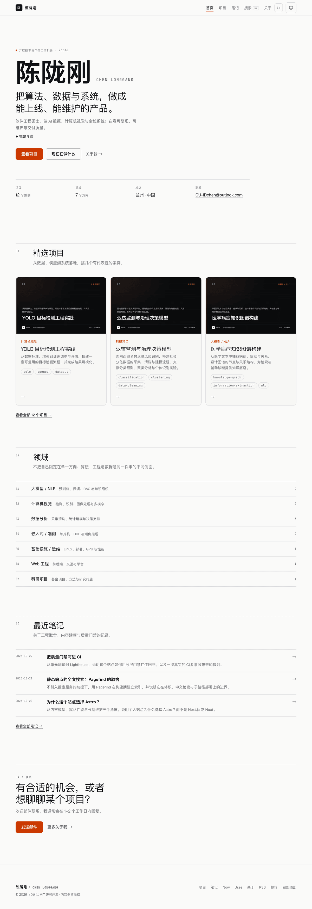
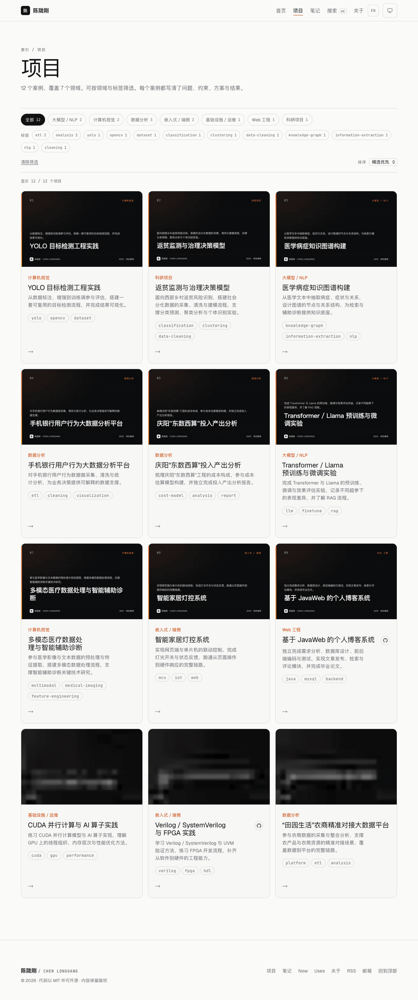
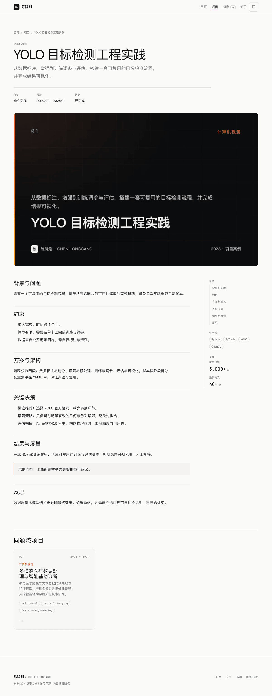
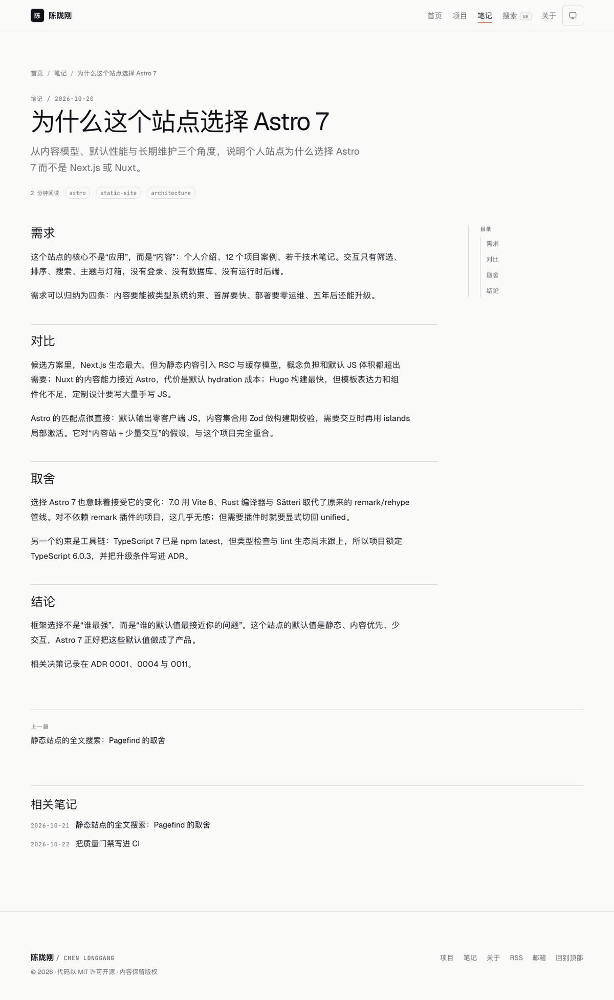
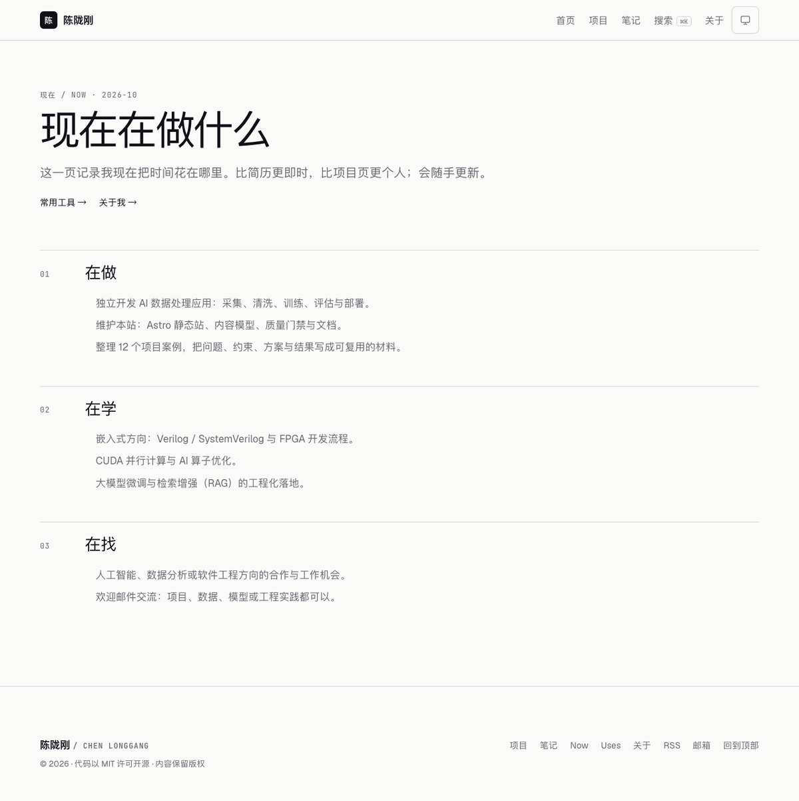
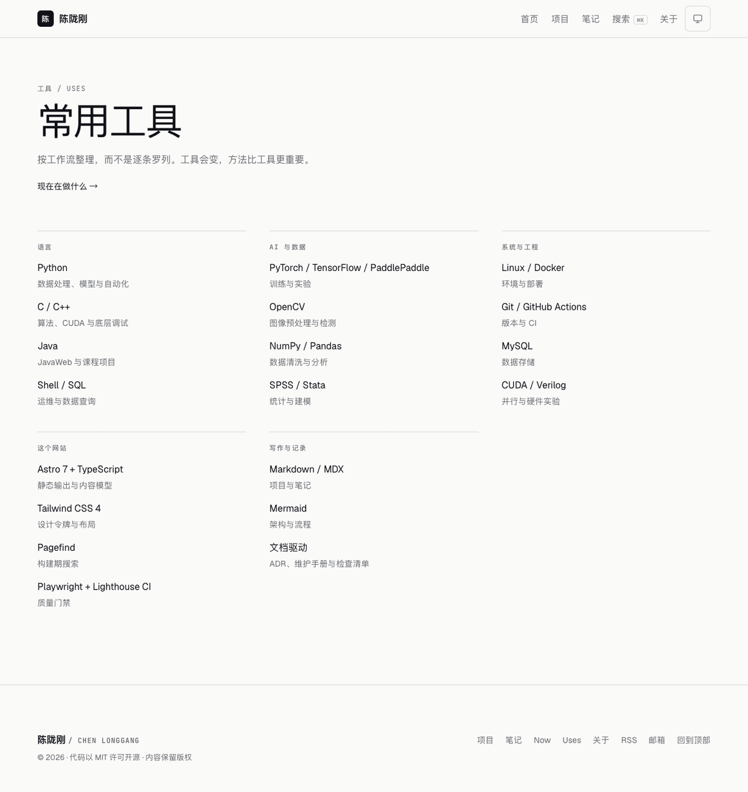
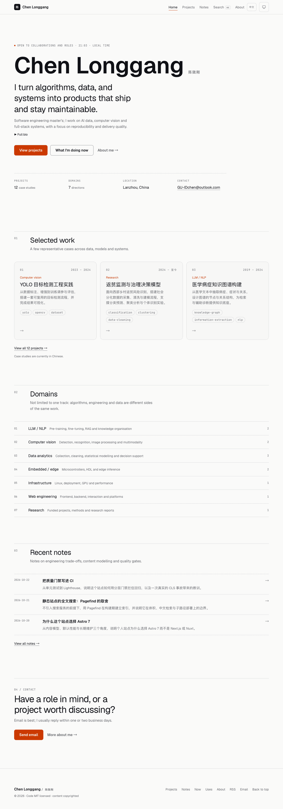
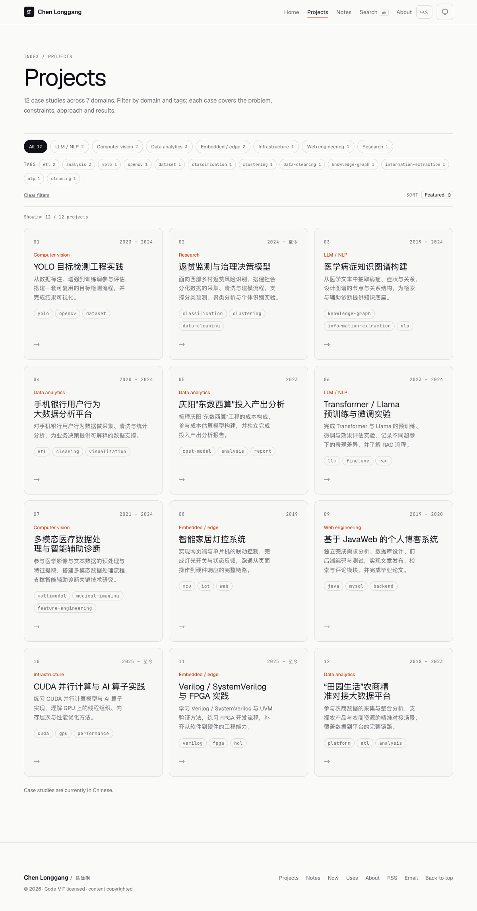

# dsh-personalnet

> 个人网站：7 个领域、12 个项目案例与 3 篇技术笔记。静态优先、零运行时后端、MIT 开源，支持中英文界面。

[](#文档)
[](./LICENSE)

## 预览

| 首页                            | 项目库                                |
| ------------------------------- | ------------------------------------- |
|  |  |

| 项目详情                              | 搜索                              |
| ------------------------------------- | --------------------------------- |
|  |  |

| 笔记列表                             | 笔记详情                                   |
| ------------------------------------ | ------------------------------------------ |
|  |  |

| 现在                           | 常用工具                            |
| ------------------------------ | ----------------------------------- |
|  |  |

| English home                               | English projects                                   |
| ------------------------------------------ | -------------------------------------------------- |
|  |  |

## 状态

| 里程碑 | 内容                                  | 状态    |
| ------ | ------------------------------------- | ------- |
| M0     | 调研、对比、架构、12 篇 ADR、文档基线 | ✅ 完成 |
| M1     | Astro 7 工程脚手架 + CI               | ✅ 完成 |
| M2     | 设计系统与页面骨架                    | ✅ 完成 |
| M3     | 内容模型与全部页面                    | ✅ 完成 |
| M4     | 搜索、动效、OG、图片优化              | ✅ 完成 |
| M5     | 质量门禁（单测/E2E/a11y/性能）        | ✅ 完成 |
| M6     | MIT 开源发布 v1.0.0                   | ✅ 完成 |
| M7     | 维护基线（手册/简历页/robots/脚手架） | ✅ 完成 |
| M8     | 技术笔记、合并 RSS、SEO 审计、LQIP    | ✅ 完成 |
| M9     | 审阅借鉴、Hero、Now/Uses、命令面板    | ✅ 完成 |
| M10    | 中英文界面、/en 路由、hreflang        | ✅ 完成 |

## 技术栈

| 层   | 选择                                               |
| ---- | -------------------------------------------------- |
| 框架 | Astro 7（静态输出、islands）                       |
| 语言 | TypeScript 6（`@astrojs/check` 当前不支持 TS 7）   |
| 样式 | Tailwind CSS 4 + OKLCH 设计令牌                    |
| 内容 | Content Collections + Zod + MDX（项目与笔记）      |
| 搜索 | Pagefind（构建期索引，零服务）                     |
| 测试 | Vitest 5、Playwright 1.64、axe-core、Lighthouse CI |
| 部署 | GitHub Pages（主）/ Cloudflare Pages（备）         |
| 许可 | MIT                                                |

选型依据见 [技术调研](./docs/03-research-landscape.md) 与 [方案对比](./docs/04-technology-comparison.md)。

## 快速开始

```bash
# 需要 Node ≥22.23.4、pnpm ≥7.1
pnpm install
pnpm dev        # http://localhost:4321
```

常用命令：

```bash
pnpm dev             # 本地开发
pnpm build           # 生产构建
pnpm preview         # 预览构建产物
pnpm check           # astro check（类型 + 内容 schema）
pnpm lint            # ESLint
pnpm test:unit       # 单元测试
pnpm test:coverage   # 覆盖率（阈值 80/70）
pnpm test:e2e        # Playwright（含 axe 可访问性）
pnpm test:a11y       # 仅可访问性
pnpm test:integration # 构建产物集成校验
pnpm check:budget    # 体积预算
pnpm perf            # Lighthouse CI
pnpm test:docs       # 文档索引与结构
pnpm test:seo        # 中文 SEO 审计（标题/描述/唯一性）
pnpm test:content    # 内容与隐私校验
pnpm gen:og          # 重新生成 OG 图与封面（需先 build）
pnpm new:project     # 新建项目骨架（草稿）
pnpm check:links     # 外部链接检查
```

## 部署

1. 仓库 Settings → Pages → Source 选择 **GitHub Actions**。
2. 设置仓库变量 `SITE_URL`（如 `https://example.com`）与 `BASE_PATH`（根域为 `/`，项目页为 `/repo/`）。
3. push 到 `main` 后由 [`.github/workflows/deploy.yml`](./.github/workflows/deploy.yml) 构建并发布。

Cloudflare Pages 备选配置见 [部署文档](./docs/11-deployment-operations.md)。

## 维护

- 发布、升级、内容运营、故障处理与回滚：[维护手册](./docs/17-maintenance-runbook.md)
- 新增项目：`pnpm new:project <slug>` → 填写 → `pnpm test:content` → `pnpm build && pnpm gen:og`
- 例行检查：每周 `pnpm check:links`、每月依赖升级、每季度 `pnpm perf` 与手工可访问性走查
- 版本策略：SemVer + annotated tag；`CHANGELOG.md` 记录每个版本

## 目录结构

```
.
├─ docs/            # 软件工程文档（22 篇 + 13 篇 ADR）
├─ src/             # Astro 源码（页面/组件/内容/样式/逻辑）
├─ scripts/         # 内容校验、体积预算、文档检查、OG 生成
├─ tests/           # unit / integration / e2e / a11y
├─ .github/         # CI、部署、Issue/PR 模板
└─ public/          # 静态资源
```

## 文档

- [文档索引](./docs/README.md)
- 决策记录：[ADR 0001–0012](./docs/adr/)
- 需求与范围：[SRS](./docs/02-requirements.md)、[愿景](./docs/01-vision-and-scope.md)
- 设计：[设计系统](./docs/06-design-system.md)、[信息架构](./docs/07-information-architecture.md)
- 内容：[内容模型](./docs/08-content-model.md)、[迁移清单](./docs/14-content-migration.md)
- 工程：[架构](./docs/05-architecture.md)、[测试](./docs/10-testing-strategy.md)、[部署](./docs/11-deployment-operations.md)
- 安全与许可：[安全、隐私与许可](./docs/12-security-privacy-licensing.md)
- 基准调研：[优秀个人网站对比与差距分析](./docs/18-benchmark-and-gap-analysis.md)
- 项目审阅：[完成度审计](./docs/19-project-completion-audit.md)、[借鉴笔记](./docs/20-borrowing-notes.md)
- 国际化：[中英文界面与路由](./docs/21-i18n.md)

## 贡献

见 [CONTRIBUTING.md](./CONTRIBUTING.md)、[行为准则](./CODE_OF_CONDUCT.md) 与 [安全策略](./SECURITY.md)。

## 许可

- 代码：[MIT](./LICENSE)
- 文字与图片：保留版权，引用请注明来源。

---

维护者：陈陇刚 · 最后更新：2026-10-23
