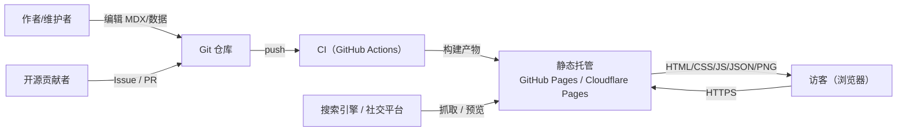
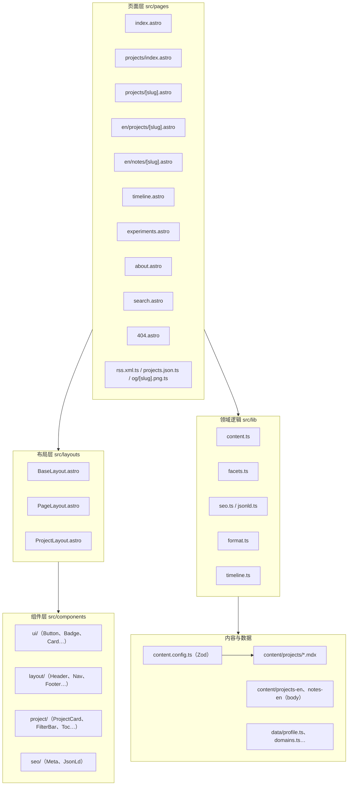
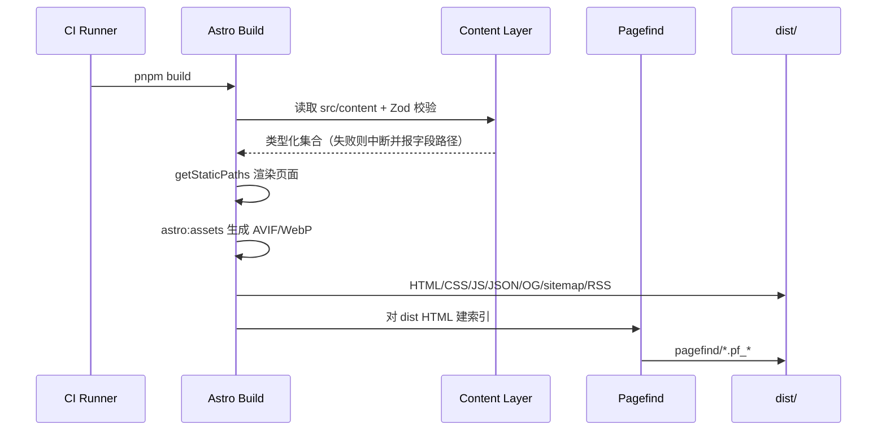
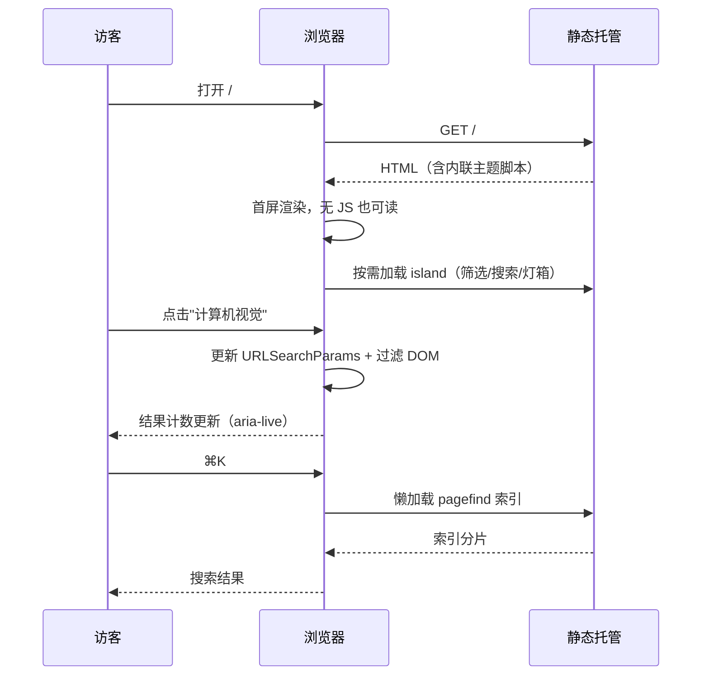
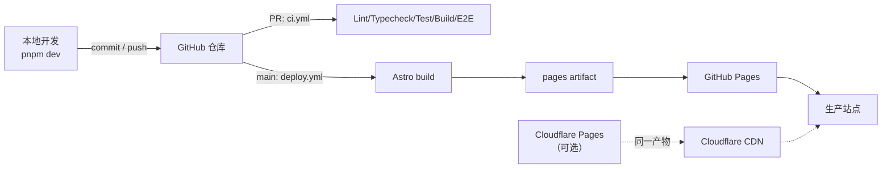

# 架构说明

采用 [arc42](https://arc42.org/) 结构，共 12 章。图表使用 Mermaid，GitHub 原生渲染。

## 1. 引言与目标

### 1.1 需求概览

个人网站：展示个人履历与 7 个领域的项目案例，静态部署、可开源、高质量（性能/可访问性/SEO）。

### 1.2 关键质量目标

| 优先级 | 质量属性 | 场景 |
|---|---|---|
| 1 | 性能 | 移动端 4G 首屏 LCP ≤1.8s，首页 JS ≤25KB |
| 2 | 内容正确性 | 非法 frontmatter 在构建期失败，定位到字段路径 |
| 3 | 可维护性 | 新增一个项目只改一个 MDX 文件，10 分钟内完成 |
| 4 | 可访问性 | 键盘可完成全部任务，axe 0 serious |
| 5 | 可移植性 | 产物为纯静态文件，可部署到任意静态托管 |
| 6 | 安全性 | 无第三方脚本、启用 CSP、无密钥 |

### 1.3 干系人

见 `01-vision-and-scope.md` §6。

## 2. 约束

| 类别 | 约束 |
|---|---|
| 技术 | Astro 7、TypeScript 6、Node ≥22.23.4；不使用运行时后端 |
| 组织 | 单人维护；AI 编码代理参与实现 |
| 法规 | MIT 许可；中国境内访问为主，需考虑移动网络 |
| 约定 | 内容中文，代码标识符英文；Conventional Commits |
| 部署 | GitHub Pages / Cloudflare Pages，无服务器进程 |
| 预算 | 托管成本 $0 |

## 3. 上下文视图（C4 L1）

外部系统：Git 托管（GitHub）、静态托管、浏览器、搜索引擎。系统**不依赖任何运行时第三方 API**；可选分析（Umami）在启用时作为唯一外部调用。

## 4. 解决方案策略

| 目标 | 策略 |
|---|---|
| 性能 | 默认零 JS；交互按需 island；图片/字体/OG 构建期生成；CSS 单文件 |
| 内容正确性 | Zod schema + 构建期校验 + 自定义内容 lint |
| 可维护性 | 内容/数据/组件/页面四层分离；设计令牌集中；组件契约文档化 |
| 美观 | 设计系统先于页面；令牌驱动；CSS 新特性渐进增强 |
| 可移植 | 纯静态输出；`SITE_URL/BASE_PATH` 环境化；无平台 API 依赖 |
| 安全 | 严格 CSP、无第三方脚本、依赖白名单、隐私默认关闭 |

## 5. 构建块视图（C4 L2）

### 5.1 模块职责

| 模块 | 职责 | 禁止 |
|---|---|---|
| `src/pages` | 路由与数据装配 | 不写业务规则 |
| `src/layouts` | 页面骨架、SEO、全局脚本挂载 | 不直接读内容集合 |
| `src/components` | 展示与交互，props 驱动 | 不访问文件系统 |
| `src/lib` | 纯函数领域逻辑（筛选、排序、SEO、格式化） | 不依赖 DOM |
| `src/content` | 内容数据（MDX）；中文元数据 + 英文 body-only | 不写代码逻辑 |
| `src/data` | 结构化个人数据（TS） | 不放长文 |
| `src/lib/timeline.ts` | 时间线解析/排序/分布（纯函数） | 不依赖 DOM |
| `public/_headers` | Cloudflare CSP/HSTS/缓存/admin noindex | 不影响 GitHub Pages |
| `scripts` | 构建/校验/生成工具 | 不参与页面渲染 |

## 6. 运行时视图

### 6.1 构建时

### 6.2 浏览器时

### 6.3 状态模型

| 状态 | 存储 | 生命周期 | 默认 |
|---|---|---|---|
| 主题 | `localStorage.theme` = `light\|dark\|system` | 持久 | system |
| 筛选/排序/查询 | URL `?domain=&tag=&q=&sort=` | 会话可分享 | 空 |
| 搜索弹窗 | DOM 状态 | 会话 | 关闭 |
| 灯箱 | `<dialog>` open | 会话 | 关闭 |

## 7. 部署视图

- 环境：本地（dev）、CI（preview 构建）、生产（Pages）。
- 域名：`SITE_URL` 注入；子路径用 `BASE_PATH`。
- 回滚：GitHub Pages 重新部署上一构建或 revert commit 触发重建。
- 缓存：静态资源文件名带 hash，可长缓存；HTML 短缓存。

## 8. 横切概念

### 8.1 类型安全

- `astro check` 全量类型检查；`tsconfig` 开启 `strict`、`noUncheckedIndexedAccess`。
- 内容 schema 单一事实来源：`src/content.config.ts` 导出的类型被 `lib` 与组件复用。
- 环境变量集中在 `src/lib/env.ts` 解析与默认值处理。

### 8.2 国际化

- UI 文案集中在 `src/lib/i18n/zh.ts`，通过 `t()` 访问；路由层预留 `/[lang]/`。
- 日期/数字格式化统一走 `Intl`，不手写拼接。

### 8.3 错误处理

| 场景 | 行为 |
|---|---|
| frontmatter 非法 | 构建失败，错误含字段路径与文件 |
| 封面缺失 | 生成渐变占位，不阻断构建 |
| Pagefind 建索引失败 | 记录警告，搜索页显示降级提示 |
| OG 生成失败 | 使用兜底图，不阻断发布 |
| 外部链接 404 | 定时检查报告，不阻断构建 |
| 404 路由 | 输出静态 `404.html` |

### 8.4 可观测性

- 构建日志：Astro 输出 + 自定义脚本统计（页面数、体积、耗时）。
- 运行时：无默认埋点；可选 Umami（环境变量开关，CSP 白名单）。
- 质量趋势：LHCI 报告与预算脚本输出归档到 CI artifact。

### 8.5 安全

- CSP 通过 Astro `security.csp`（v6 起稳定）启用，禁用内联脚本（主题脚本用 hash）。
- 无第三方运行时脚本；外链统一 `rel="noopener noreferrer"`。
- 依赖：lockfile 入库、dependabot、`pnpm audit`。

### 8.6 性能

- 关键路径：HTML → 内联 CSS（首屏关键样式）→ 字体 preload → 懒加载 JS。
- 图片：`<Picture>` 输出 AVIF/WebP，显式宽高，首屏 `fetchpriority="high"`。
- 字体：两个 woff2 子集 + `font-display: swap`。

## 9. 架构决策

23 篇 ADR 见 `adr/`，索引：0001 框架、0002 设计令牌、0003 内容模型、0004 交互层、0005 搜索、0006 i18n、0007 部署、0008 测试、0009 分析、0010 许可、0011 TS 版本、0012 后端策略、0013–0019 双语/后台/自动化/媒体/GitHub/背景，0020 英文 body-only、0021 Cloudflare CSP、0022 静态优先 WebGL、0023 静态时间线。

## 10. 质量需求与场景

| 场景 | 刺激 | 响应 | 度量 |
|---|---|---|---|
| 访客在弱网打开首页 | 4G / 1.6Mbps | 首屏 HTML 直出，JS 延后 | LCP ≤1.8s |
| 维护者新增项目 | 新建 MDX | 构建校验 + 自动上线 | ≤10 分钟 |
| 作者写错 domain | 非法枚举 | 构建失败并指出字段 | 0 个错误内容上线 |
| 用户仅用键盘 | Tab/Enter/Esc | 可完成筛选、搜索、灯箱关闭 | axe 0 serious |
| 搜索引擎抓取 | 爬虫 | sitemap + JSON-LD + canonical | 结构化数据校验通过 |
| 子路径部署 | `BASE_PATH=/repo/` | 所有链接与索引正确 | e2e 通过 |
| 英文详情 | 访问 /en/projects/<slug>/ | 英文正文、同 slug hreflang、语言切换 | E2E 通过 |
| Cloudflare CSP | 公网加载 admin/搜索 | 响应头 + meta 交集，无 console 错误 | curl + 浏览器 |

## 11. 风险与技术债

| 项 | 说明 | 应对 |
|---|---|---|
| Astro 7 生态迁移 | Sätteri 取代 remark | 不使用 remark 插件；跟踪升级公告 |
| TS 7 未支持 | astro check peer 限制 | 锁 TS 6，ADR 0011 |
| Pagefind 与 base path | 索引路径问题 | 专项构建 + e2e |
| 内容量增长 | 构建时间上升 | 增量构建、OG 缓存、按需生成 |
| 单维护者 | 知识集中 | 文档 + ADR + 自动化门禁 |
| TD-01 详情视图重复 | 中英文项目/笔记详情各一份 | ✅ 2.9.2 已抽共享视图（ADR 0024） |
| TD-02 实验脚本内联 | experiments.astro 偏大 | P2：抽脚本/组件 |
| TD-03 SEO 标题特判 | 长英文标题需手工映射 | P2：schema seoTitleEn |
| TD-04 CI 性能抖动 | 共享 runner TBT 波动 | 局部重跑 + 性能证据 |
| TD-05 Token 暴露 | 自动部署凭据风险 | 立即轮换 |

## 12. 术语

见 `00-glossary.md`。