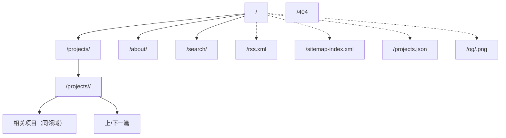

# 信息架构与页面规格

## 1. 站点地图



## 2. 导航模型

| 位置 | 内容 |
|---|---|
| 顶部导航 | 首页、项目、关于、搜索（图标+快捷键提示）、主题切换 |
| 页脚 | 版权、GitHub 仓库、RSS、许可证、返回顶部 |
| 项目详情 | 面包屑（首页 / 项目 / 当前）、TOC（桌面侧栏） |
| 移动端 | 汉堡按钮打开原生 popover 菜单，Esc 关闭，焦点陷阱 |

主导航 4 项以内，当前页用 `aria-current="page"` + 下划线标记。

## 3. 页面规格

### 3.1 首页 `/`

```
┌──────────────────────────────────────────────┐
│ Header（logo / nav / 搜索 / 主题）            │
├──────────────────────────────────────────────┤
│ 状态徽标（可合作 / 在职 / 开放交流）           │
│ H1 姓名                                       │
│ 定位一句话（角色 + 领域广度）                  │
│ 简介 2 行 + 主按钮[查看项目] 次按钮[关于我]     │
│ 元信息：所在城市 · 邮箱 · GitHub              │
├──────────────────────────────────────────────┤
│ 精选项目 01  [卡片] [卡片] [卡片]              │
├──────────────────────────────────────────────┤
│ 领域总览 02  7 个领域 + 计数（可点击进入筛选）  │
├──────────────────────────────────────────────┤
│ 能力矩阵 03  分类技能标签                      │
├──────────────────────────────────────────────┤
│ 履历摘要 04  教育/经历时间线（精简 3 条）       │
├──────────────────────────────────────────────┤
│ 联系 CTA + Footer                             │
└──────────────────────────────────────────────┘
```

内容优先级：H1 姓名 > 定位 > 精选项目 > 联系方式 > 领域 > 履历。

### 3.2 项目库 `/projects/`

```
┌──────────────────────────────────────────────┐
│ H1 项目  ·  说明一段                          │
│ [全部 12] [大模型 2] [视觉 2] [数据 3] …       │
│ 标签: [YOLO] [RAG] …  排序: [精选 ▾]  [搜索]   │
│ 结果计数：显示 12 个项目（aria-live）          │
├──────────────────────────────────────────────┤
│ [卡片] [卡片] [卡片]                           │
│ [卡片] [卡片] [卡片]                           │
└──────────────────────────────────────────────┘
```

- 领域 chips 显示计数，选中态 `aria-pressed="true"`。
- 标签为多选，选中后与领域取交集。
- 排序：精选优先（默认）、最新、名称。
- 空态：说明当前筛选无结果 + 一键清除。
- URL 同步：`?domain=&tag=&sort=`，使用 `history.replaceState`，刷新与分享可还原。

### 3.3 项目详情 `/projects/<slug>/`

```
┌──────────────────────────────────────────────┐
│ 面包屑                                        │
│ H1 标题 + 一句话摘要                          │
│ 元信息：角色 / 周期 / 领域 / 状态              │
│ 技术栈标签 + 外链（仓库/演示/论文）            │
├───────────────────────────┬──────────────────┤
│ 封面图（16:10）            │ 指标卡片          │
│ 正文（六段式）             │ TOC（sticky）     │
│ 图库                       │ 相关项目          │
├───────────────────────────┴──────────────────┤
│ 上一篇 / 下一篇                                │
└──────────────────────────────────────────────┘
```

正文固定六个 H2：背景与问题、约束、方案与架构、关键决策、结果与度量、反思。缺失小节时构建告警（不阻断），但上线前应补齐。

### 3.4 关于 `/about/`

结构：自述（3 段以内）→ 技能分组 → 教育 → 经历时间线 → 现在在做 → 常用工具 → 联系方式。所有信息来自 `src/data/profile.ts` 与 `timeline.ts`，不硬编码在模板中。

### 3.5 搜索 `/search/`

- 顶部大搜索框（自动聚焦，但不劫持 IME）。
- 结果按类型（项目/正文/笔记）分组，显示标题、摘要、领域标签。
- 键盘：↑/↓ 选择、Enter 打开、Esc 关闭。
- 无结果：显示建议关键词与"浏览全部项目"链接。
- 索引加载失败：显示静态说明与项目库入口（不白屏）。

### 3.6 404

大号"404"排版 + 一句话 + [返回首页] [浏览项目]。保持 Header/Footer，状态码由托管平台返回 `404`。

## 4. 响应式行为

| 断点 | 布局 |
|---|---|
| <640 | 单列；卡片全宽；TOC 折叠为"目录"按钮；导航为 popover |
| 640–1023 | 2 列卡片；单列正文；TOC 仍折叠 |
| ≥1024 | 3 列卡片；正文 + 侧栏（TOC/相关）；导航全展开 |
| ≥1280 | 最大宽 1280 居中，额外留白 |

## 5. 渐进增强与无 JS

- 所有内容服务端渲染，JS 只增强筛选/排序/搜索/主题/灯箱。
- 无 JS 时：卡片全部显示；领域 chips 渲染为锚点链接，跳到对应分组；主题跟随系统；灯箱退化为新标签打开原图。
- 筛选脚本在 `<script type="module">` 中执行，失败不影响内容可见。

## 6. URL 与重定向

- 统一 `trailingSlash: 'always'`，目录式输出（`build.format: 'directory'`）。
- `/projects/<slug>/` 的 slug 为 kebab-case，一旦发布不得更改；如需更改须加重定向说明（静态托管用 `_redirects` 或 meta refresh，Cloudflare 支持 `_redirects`）。
- 查询参数不参与 SEO，筛选后的页面 canonical 始终指向无参数版本。

## 7. 内容优先级（每页）

| 页面 | 第一屏必须可见 | 次要 |
|---|---|---|
| 首页 | 姓名、定位、主 CTA | 精选项目、联系方式 |
| 项目库 | H1、筛选、结果计数 | 排序、搜索入口 |
| 详情 | 标题、摘要、元信息 | 指标、图库 |
| 关于 | 自述首段 | 技能、时间线 |